<p align="center">
  
</p>

# Kagwa Wire

An on-phone check before a peer-to-peer USDT release. It reads an address or a chat on the device and shows one level: **Stop**, **Check more**, **No flags found**, or **Can't tell**, with the reason and the text that triggered it.

Kagwa Wire does not hold funds, does not sign anything, and does not send a transaction. "No flags found" means the checks that ran found nothing.

The pictures in this README are renders of the **Expo web build in a browser**. The Android phone build has not been run. On that web build, Screenshot and Scan QR are marked "On the phone", the setup screen shows 0.0 MB because the web build does not carry the model file sizes, and short chat tags are labelled "demo tag, web build". They are not output from the on-device QVAC model.

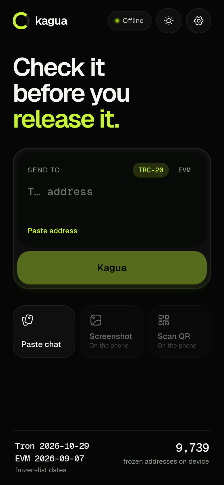

## Hackathon submission at a glance

| | |
| --- | --- |
| Event | AI Yako 2026, on DoraHacks. The project mission names QVAC, Tether, and Node NBO. Page: https://dorahacks.io/hackathon/ai-yako/detail |
| Track | Offline AI apps |
| Deadline in the mission doc | Friday 30 October 2026, 14:00 UTC |
| Team | Lamptey Isaiah (hacker name: Isaiah Amber), engineer. Built solo. |
| Repository | https://github.com/Amberesaiae/kagua |
| Demo video | To be added |
| QVAC feature | The on-device chat tagger. It returns tags tied to quoted text. It does not choose the level. Screenshot reading uses the QVAC OCR model. Address checks are ordinary code, not the model. |
| Offline claim | A check does not start a download and does not contain a `fetch` in this repository's own source. The on-device model is meant to be downloaded once, then used with the network off. That phone run has not been done. See [What still needs a network](#what-still-needs-a-network). |
| Finance actions | None. No wallet, no signing, no transfer. The Wallet Development Kit is listed as cut in `docs/internal/cloud-run/MISSION.md`. |

[SUBMISSION.md](SUBMISSION.md)

## The problem

A peer-to-peer USDT trade often ends with one person releasing coins after a chat, a pasted address, or a picture of a payment. The failure modes this repository actually checks for are:

- An address that fails its checksum, sits on a different network from the one selected, matches a frozen-address entry, or shares the first four and last four characters of a saved contact while the middle differs.
- A chat that asks for a seed phrase, a PIN or password, or a one-time code.
- A chat that rushes the trader, pushes the talk off the trading app (WhatsApp, Telegram, Signal, or the Swahili "nje ya"), poses as an exchange or an admin, poses as support, or claims a payment was already made and asks for release.

The Check more screen tells the trader to open M-Pesa in their own SMS, not the buyer's screenshot. Kagwa Wire does not decide whether a payment image is genuine. Receipt reuse (a hash of a payment image, kept in a local ledger) is named in the mission and is not in the code.

This README does not include fraud statistics, sums of money, or a claim that no other entry does this. `docs/internal/cloud-run/LEARNINGS.md` says those kinds of figures are unverified and stay out of the repo.

## Who needs it

The mission describes the user as a USDT trader who checks before they release or send. The tagger prompt in `packages/core/src/qvac.ts` says the chat is from a peer-to-peer USDT trade and may be English or Swahili. It tells the model not to tag ordinary payment notes such as M-Pesa, MTN MoMo, or a reference number. The result screens mention M-Pesa and a bank app.

The repository does not contain a user study, a trader count, or a city list. This README does not name countries or cities as a measured audience.

## The solution and how it works

Code chooses the level. A model may only add tags. Tags can raise "nothing found" to Check more. They cannot lower a level, and they cannot produce Stop. That rule is `decide` in `packages/core/src/chat.ts`, and the tests cover it.

If the code already has a Stop, the check does not wait for the model. If the model throws, times out (20 seconds), or was not asked, the code result still stands. If there is nothing to read, the screen is Can't tell.

The four levels:

| Level | When the code shows it |
| --- | --- |
| Stop | Invalid checksum on a well-shaped address, wrong network, frozen list, look-alike of a saved contact, or a chat that asks for a seed phrase, PIN, password, or one-time code. |
| Check more | Softer chat rules (pressure, off-platform, impersonation, fake support, a payment claim), or a model tag that survived the quote checks. |
| No flags found | A valid address that is not on the frozen list, or an exact saved contact, or a chat whose rules and tags found nothing. The wording says this proves nothing about the trade. |
| Can't tell | Empty input, a string that is not a TRC-20 or EVM address, a QR with no single address, a screenshot that could not be read, or a screenshot check before the phone model is downloaded. |

A check does not call the download. On the phone, the tagger is used only when both model files are already loaded or `getModelInfo` says both are already cached. Otherwise the check runs on the written rules alone. The web build has no QVAC provider. It uses a keyword mock, and those tags are labelled "demo tag, web build".

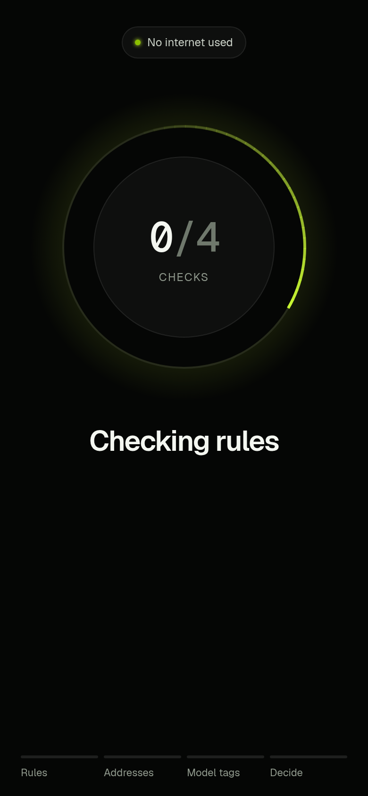

### Stop

The Stop screen says "Don't send." A frozen-list hit uses this wording from `packages/core/src/address.ts`: "Tether has frozen this address. That isn't proof of a scam, but funds sent there may be stuck." The address in the picture is the Tron USDT contract `TR7NHqjeKQxGTCi8q8ZY4pL8otSzgjLj6t`, which the bundled list contains. It is a list demo, not a judgement that the contract is a scam.

The "Send anyway" control stays locked for 30 seconds. When it unlocks, the label is "Send anyway. Kagua sends nothing." Pressing it returns to the check screen. It does not create a transaction. On a phone the Stop screen asks for an error haptic. The web build does not.

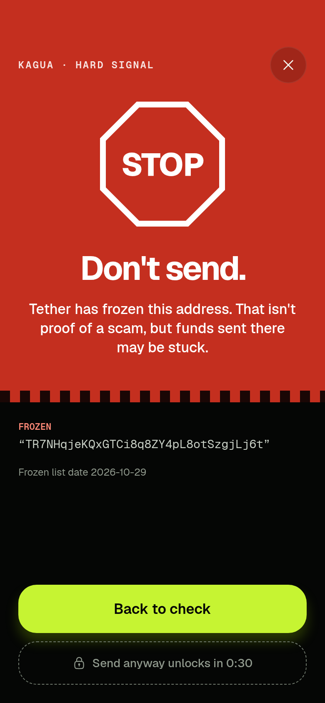

### Check more

The headline is "Confirm 3 things before you release." The three boxes are local ticks: open M-Pesa in your own SMS, match the amount, match the sender name. The button stays disabled until all three are ticked, then it returns home. Kagwa Wire does not check those three things itself.

Quoted lines come from the written rules or from tags. Model lines are marked. In the web picture below, the long quotes are the code rules and the short quotes are the web demo tagger.

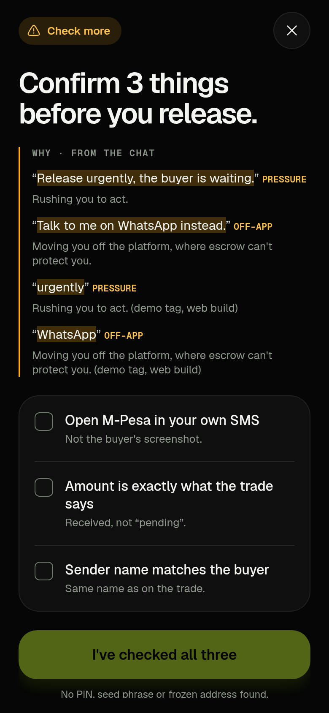

### No flags found

The screen uses the theme background, near-black #050605 or off-white #F3F4EE, and an information icon. It does not use the Stop red #C42F1F. For an address it says the address is not on the frozen list as of that network's list date, and that this proves nothing. It also says to confirm the payment in the trader's own M-Pesa or bank app. The timings on the screen are how long those steps took in that run. In this web picture each step is shown as under 1 ms. That is the screen's own timer for that browser check. It is not a phone measurement.

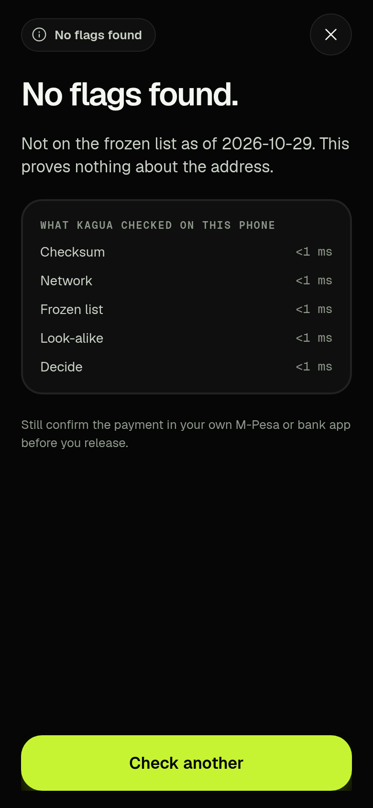

### Can't tell

If the paste is not a TRC-20 or EVM address, the screen says so and asks the trader to check the copy. A checksum failure on a real address shape is Stop, not Can't tell. A leading `0X`, a 41-character hex Tron form, or a string that is empty after invisible characters are stripped is Can't tell.

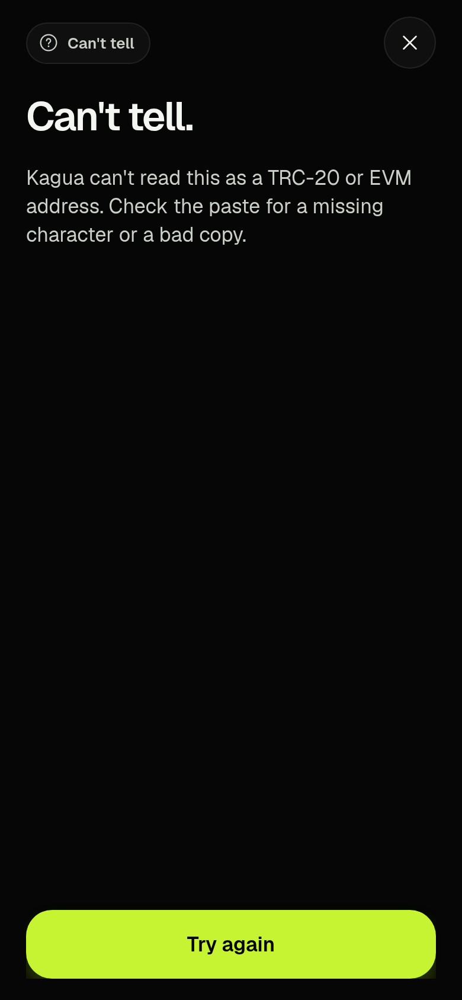

## Features

### Address check

`packages/core/src/validate.ts` and `packages/core/src/address.ts`:

- Tron: base58check, 21-byte payload, version byte `0x41`.
- EVM: 40 hex digits after `0x`. Mixed-case addresses must match EIP-55. All-lowercase and all-uppercase are accepted.
- Wrong network: the shape is for the other network from the one selected (TRC-20 or EVM). That is Stop.
- Frozen list: the bundled file `packages/core/data/frozen.json`. Counts in that file are 8,089 Tron and 1,650 EVM (9,739). Tron list date 2026-10-29. EVM list date 2026-09-07. Provenance is `packages/core/data/frozen.provenance.json`.
- Look-alike: same network, same length, first four and last four characters match a saved contact, middle differs. That is Stop, with the saved address and the pasted address shown side by side. An exact match of a saved contact is No flags found, and the text says that proves nothing about the trade.
- Whitespace and invisible paste characters are stripped on the typed address and on saved contacts before the compare.

The frozen list is built by `packages/core/scripts/build-frozen.ts`, which the app does not run. Tron entries are the net of `AddedBlackList` and `RemovedBlackList` events on the Tron USDT contract, pulled from TronGrid on 29 October 2026. EVM entries are the `is_banned` Ethereum rows of the USDT Blacklist Archive snapshot dated 2026-09-07. The archive is CC-BY-4.0, attributed to KYT Group / cryptoalert.report (https://huggingface.co/datasets/cryptoalert/usdt-blacklist-archive). The same provenance file records a cross-check: 16 Tron addresses only in the archive, 1,809 only on the chain pull. The chain is the source used for Tron. The gap is not fully explained. See the open decision in `docs/internal/cloud-run/PROGRESS.md`.

Not being on the list proves nothing. Being on the list is not, by itself, proof of a scam.

### Chat check

Paste is `apps/mobile/src/app/chat.tsx`. The screen says the check looks for PIN, seed phrase and code requests, frozen or look-alike addresses inside the text, and pressure, in English and Swahili.

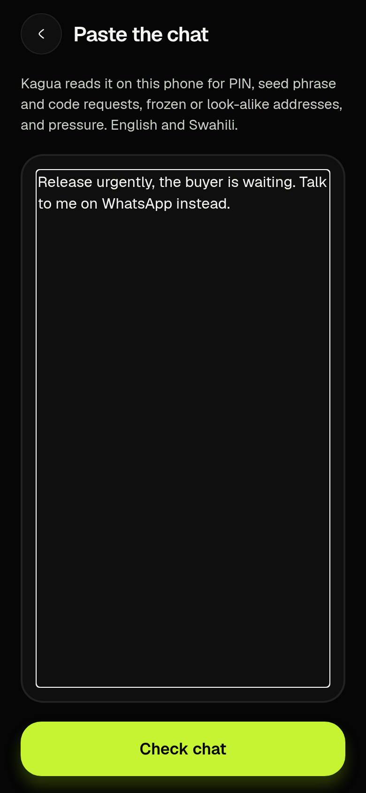

Hard rules (Stop) and soft rules (Check more) are the lists `HARD_RULES` and `SOFT_RULES` in `packages/core/src/chat.ts`. A mention inside "never" or "don't" is not treated as a request. "Can you pin this chat?" is not a PIN request. Addresses in the chat, including ones split by a space or a line break, are checked when the checksum still holds.

On the phone, after both models are on disk, the QVAC tagger may add pressure, impersonation, off-platform, or fake-support tags. A tag is kept only when the span is copied from the chat, is at least four characters, is not essentially the whole message, is not inside a negated warning, and contains a cue word. Anything else is dropped. The model never returns a level. The prompt and the JSON schema are in `packages/core/src/qvac.ts`.

The web build does not run that model. `apps/mobile/src/model/provider.web.ts` sets the provider to null, and `apps/mobile/src/state/engine.ts` uses `createMockProvider` instead. Mock tags are labelled on the result.

Screenshot reading is a phone path. The home tile is disabled on the web build ("On the phone"). On the phone it needs the models downloaded first. OCR uses `OCR_LATIN` with `langList: ['en']` in `createQvacProvider`. Swahili phrases in the written rules are not the same thing as Swahili OCR. OCR language coverage beyond that English list is not claimed.

Chat text is not stored. A recent check keeps the level and the word "Chat" or "Screenshot", not the message. Contacts, recent checks, and theme are SQLite on the phone (`apps/mobile/src/state/db.ts`) and `localStorage` on the web build (`apps/mobile/src/state/db.web.ts`). Wipe clears contacts, recent checks, and settings. It leaves a downloaded model in place.

### QR scan

`parseQr` in `packages/core/src/qr.ts` accepts a bare address, `tron:<address>`, and EIP-681 `ethereum:<address>`, including a token `transfer` whose recipient is the `address` parameter rather than the contract. If it cannot read one address, it returns null and the scan screen says Can't tell.

The phone screen is `apps/mobile/src/app/scan.tsx`. It uses `expo-camera` and does not save the image. The home screen does not open Scan QR on the web build. There is no QR screenshot in this README because the supplied pictures are the web build, where that tile is off.

### Receipts

Not in the code. `docs/internal/cloud-run/PROGRESS.md` still has receipt reuse (SHA-256, a perceptual hash, and a ledger) unchecked. SHA-256 in the repository today is the Tron checksum and the hash of the frozen-list file. It is not a receipt check.

### Light and dark

Theme tokens live in `apps/mobile/src/theme/tokens.ts`. Settings can follow the system, or force dark or light. The dark background is #050605. The light background is #F3F4EE. Action buttons are lime #C6F432. The Stop screen uses #C42F1F, and that red is only for Stop. Check more uses the warning amber from the same file (#FFB020 on the dark theme). No flags found and Can't tell stay on the theme background.

Brand: the wire logo.

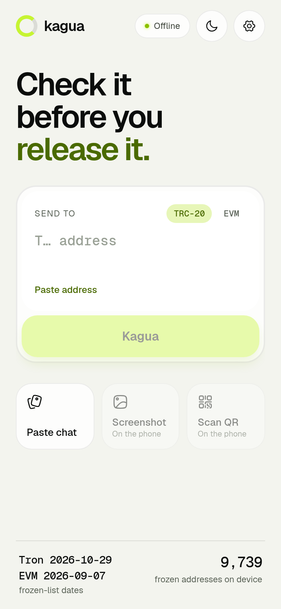

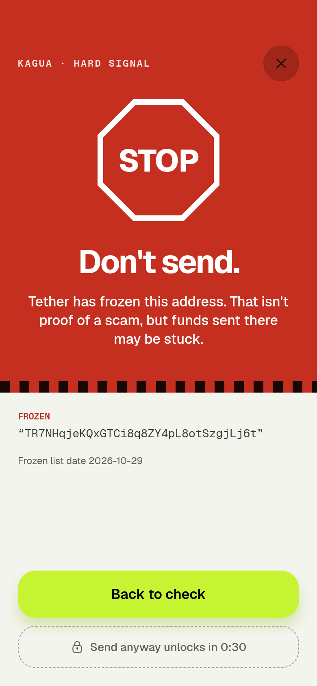

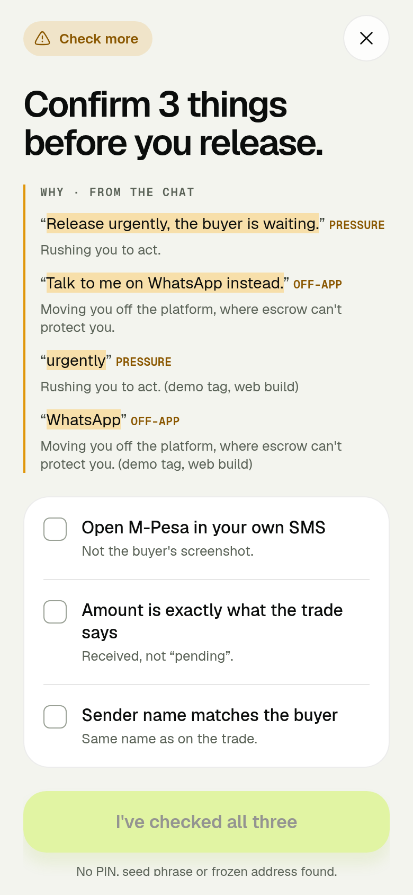

### Landing page

The landing page (separate PR).

## How QVAC is used

Direct dependency, from `apps/mobile/package.json` and the lockfile: `@qvac/sdk` **0.22.0**. The lockfile also resolves `@qvac/inference` 0.22.0 (the model catalogue), `@qvac/llm-llamacpp` 0.61.2, and `@qvac/ocr-ggml` 0.29.1.

`apps/mobile/qvac.config.js` puts only `PLUGIN_LLM` and `PLUGIN_OCR` into the phone worker bundle.

`apps/mobile/app.json` registers the plugin `@qvac/sdk/expo-plugin`. In the installed 0.22.0 package that plugin sets Android `minSdkVersion` 29, NDK `29.0.14206865`, and ABI filter `arm64-v8a` only.

Models, from the catalogue in `@qvac/inference` 0.22.0 (`dist/models/registry/models.js`). The same byte sizes are recorded in `docs/internal/cloud-run/LEARNINGS.md`.

| Constant | What it is | Registry file | `expectedSize` |
| --- | --- | --- | --- |
| `OCR_LATIN` | GGML OCR, Latin. The SDK comment names an EasyOCR pipeline and says a CRAFT detector is derived automatically. | `qvac_models_compiled/ocr/gguf/easyocr/2026-05-14/latin_g2.gguf` (registry source `s3`) | 15,396,512 bytes |
| `QWEN3_600M_INST_Q4` | Chat tagger. Catalogue fields: Q4, 600M, engine `llamacpp-completion`, model id `Qwen3-0.6B-Q4_0.gguf`. | `unsloth/Qwen3-0.6B-GGUF/.../Qwen3-0.6B-Q4_0.gguf` (registry source `hf`) | 382,156,480 bytes |

The setup screen divides those sizes by 1,000,000 and shows one decimal place, and it says the OCR text detector adds a small extra file. That extra file's size is not in `expectedSize`. On the web build both sizes are hardcoded to 0, which is why the picture shows 0.0 MB. Model download time and the real total on a phone are not measured.

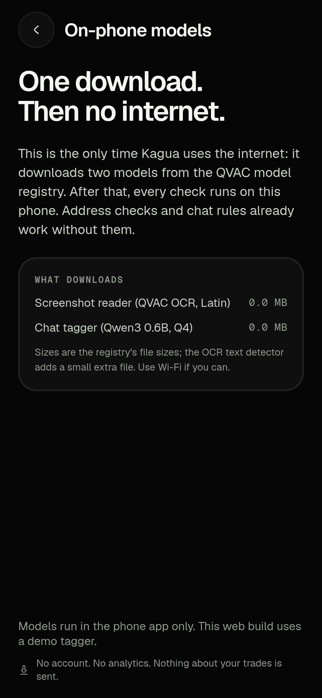

Files that use QVAC:

| File | Role |
| --- | --- |
| `apps/mobile/src/model/provider.ts` | Phone provider. Passes `loadModel`, `ocr`, `completion`, and `getModelInfo` from `@qvac/sdk` into the core adapter, with `OCR_LATIN` and `QWEN3_600M_INST_Q4`. |
| `apps/mobile/src/model/provider.web.ts` | Web build. No SDK import. Provider is null. Sizes are 0. |
| `packages/core/src/qvac.ts` | `createQvacProvider`. Core does not import the SDK. Tests pass a fake. Prompt, JSON schema, temperature 0, `top_k` 1, seed 1. |
| `packages/core/src/provider.ts` | `ModelProvider` interface (`ocr`, `tagChat`), tag sanitiser, chat and screenshot runners, and `createMockProvider`. |
| `apps/mobile/src/logic/tagger.ts` | Uses the phone model only if it is already loaded or already cached. Does not download. |
| `apps/mobile/src/app/setup.tsx` | The download screen. Calls `prepare`. |
| `apps/mobile/qvac.config.js`, `apps/mobile/app.json` | Which plugins ship, and the Expo plugin. |

The interface is `ModelProvider` in `packages/core/src/provider.ts`. The phone implementation is `createQvacProvider`. The mock is `createMockProvider`, used by tests and by the web build. A provider returns tags and OCR text. It does not return a level.

`docs/internal/cloud-run/PROGRESS.md` says the adapter was written from the npm package's type declarations and shipped examples, because `docs.qvac.tether.io` was blocked in that environment. It has not been checked against that docs site. The handover date on that note is 29 October 2026, 11:10 UTC.

## Architecture

`packages/core` is plain TypeScript. It has no UI and it does not import `@qvac/sdk`. `apps/mobile` is the Expo app (SDK 54, Expo Router, React Native 0.81.5, React 19.1.0). Data files are the frozen list and its provenance JSON.

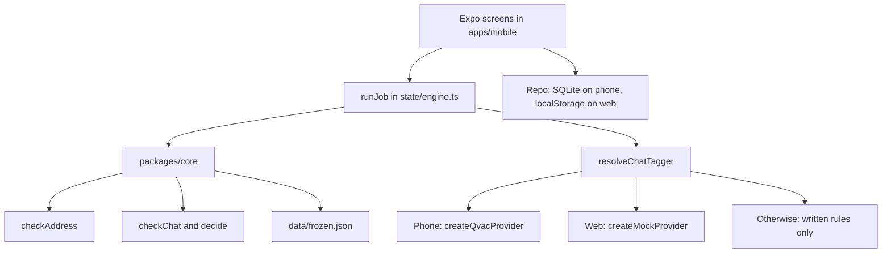

Address steps timed for the checking screen are Checksum, Network, Frozen list, Look-alike, and Decide. Chat steps are Rules, Addresses, then Model tags only if a model actually ran, then Decide. A screenshot adds Read image first. The step functions time the work. The level still comes from `checkAddress` or `checkChat`.

## What still needs a network

There is no `fetch` in `packages/core/src` or in `apps/mobile`. The app's own check path does not download. These are the network uses that do exist, taken from the code:

1. **Model download, first run, phone only.** `apps/mobile/src/app/setup.tsx` calls `prepare`, which calls `loadModel` for `OCR_LATIN` and `QWEN3_600M_INST_Q4`. The screen text says this is the time Kagua uses the internet, and that the files come from the QVAC model registry. The web build has no provider, so that button does not download. Whether the one-time download is acceptable for the offline demo is an open question in `docs/internal/cloud-run/PROGRESS.md` (the note says to ask the organisers). It is not answered here.

2. **Frozen-list refresh, build machine only.** `packages/core/scripts/build-frozen.ts` fetches the Hugging Face parquet and TronGrid events. The file's own comment says it is build-time only and the app never runs it. A running check reads the committed JSON. There is no in-app updater.

3. **Waitlist page.** Not in this branch. It is in a separate pull request. It is not part of a check.

4. **Web QR scanner script, only if that screen loads.** The home screen does not open Scan QR on the web. If the web build does load `apps/mobile/src/app/scan.tsx`, that screen imports `expo-camera` 17.0.10. That package's `src/web/useWebQRScanner.ts` starts a worker whose script is `https://cdn.jsdelivr.net/npm/jsqr@1.2.0/dist/jsQR.min.js`. The phone scan screen uses the native camera. This repository does not add that URL itself.

`getModelInfo` in `@qvac/inference` 0.22.0 stats local cache files for a single-file catalogue model (`fsPromises.stat`, and `isCached` when the size matches). The same handler has a CoreML branch that can call `getRegistryClient()`. The two models Kagwa Wire names do not set `shardMetadata` or `companionSet` on their catalogue entries. `packages/core/src/qvac.ts` comments that the probe must not download. Pull request #1 says this path was not repeated inside a network namespace. An offline-proof script that logs every outbound attempt does not exist yet (`scripts/offline-proof.ts` is unchecked in the progress doc).

`docs/internal/cloud-run/PROGRESS.md` records that a web build, checked in headless Chromium on 29 October 2026 at 09:40 UTC, made 0 requests to other hosts in dark and light. That note is from before the later bug-fix commit. It was not re-run for this README. It is not a phone test, and it is not airplane mode.

Fonts are loaded from the app bundle (`apps/mobile/src/app/_layout.tsx` says nothing is fetched for them). The web build stores data in `localStorage` rather than downloading the expo-sqlite WASM.

## Setup and run

Prerequisites written in the repo: Node.js and npm (this repository sets no `engines` field), and for QVAC a physical arm64 phone. `docs/internal/cloud-run/MISSION.md` says Android 12 or newer, and no emulator. The installed Expo plugin sets `minSdkVersion` to 29, which is a lower API floor than Android 12. See [Device, operating system, memory, and licences](#device-operating-system-memory-and-licences). No phone model is confirmed.

From the repository root, the scripted commands are:

```bash
npm install
npm test
npm run typecheck
```

`npm test` runs `npm test -w @kagua/core -w @kagua/mobile`. `npm run typecheck` runs `tsc -p packages/core` and `tsc -p apps/mobile`.

On 30 October 2026 those two commands were run in this workspace with Node.js 22.23.4 and npm 10.9.9. `@kagua/core` reported 58 passed tests. `@kagua/mobile` reported 22 passed tests. `npm run typecheck` finished with no errors. That run does not start a phone or a model.

Web dev server, from `apps/mobile/package.json`:

```bash
npm run web -w @kagua/mobile
```

That script is `expo start --web`. There is no export script in `package.json`. `apps/mobile/app.json` sets the web output to `single`. The screenshots are from a web build opened in a browser. This README does not record a separate export command, because the repository scripts do not contain one.

Phone dev build, as written in the progress handover, and not yet run:

```bash
cd apps/mobile
npx expo prebuild -p android
npx expo run:android
```

`npm run android -w @kagua/mobile` is a different command. It is `expo start --android`, the Expo dev server, not the native prebuild. QVAC's worker is bundled at prebuild. The repository does not document the JDK or Android SDK install. The plugin pins NDK `29.0.14206865`.

After a native build, the progress doc's phone list is: download models from Settings, turn on airplane mode, force-close, reopen, and run a chat check and a screenshot check. Record the download size, the time, and the RAM. None of that has been done.

## Device, operating system, memory, and licences

| Item | What the repo supports | Not yet confirmed |
| --- | --- | --- |
| Phone | Physical arm64 device. Plugin ABI filter is `arm64-v8a` only. Mission says no emulator. | The actual phone model and its Android version. No device has run the app. |
| OS floor | Mission text: Android 12+. Plugin `minSdkVersion`: 29. | Which of those two floors a real device must meet. iOS is present in `app.json` and in the plugin's iOS prebuild list. No iOS run is recorded. |
| NDK | `29.0.14206865`, set by `@qvac/sdk/expo-plugin` 0.22.0. | A completed native build. |
| Model files | 15,396,512 bytes (`OCR_LATIN`) and 382,156,480 bytes (`QWEN3_600M_INST_Q4`), from the installed catalogue. | Download time, the detector's extra bytes, disk used on a phone, and RAM while a check runs. |
| Runtime memory | Not measured anywhere in the repo. | All of it. |

Package licences read for this README from the installed tree (lockfile versions):

| Package | Version | Licence as read |
| --- | --- | --- |
| `@qvac/sdk` | 0.22.0 | Apache-2.0. `LICENSE` file in the package. |
| `@qvac/inference` | 0.22.0 | Apache-2.0. `license` field in its `package.json`. |
| `@qvac/llm-llamacpp` | 0.61.2 | Apache-2.0. `license` field in its `package.json`. |
| `@qvac/ocr-ggml` | 0.29.1 | Apache-2.0. `LICENSE` file in the package. The package describes GGML OCR for EasyOCR and DocTR pipelines. That is the code licence, not a weight licence. |
| `react-native-bare-kit` | 0.16.0 | Apache-2.0. `LICENSE` file in the package. |
| `@noble/hashes` | 1.8.0 | MIT. `LICENSE` file, copyright Paul Miller. Used for the Tron checksum and EIP-55. |
| `expo` | 54.0.38 | MIT. `license` field. No `LICENSE` file was in the installed package. |
| `expo-camera` | 17.0.10 | MIT. `license` field. |
| `expo-sqlite` | 16.0.10 | MIT. `license` field. |
| `react` and `react-dom` | 19.1.0 | MIT. `license` field. |
| `react-native` | 0.81.5 | MIT. `license` field. |
| `react-native-web` | 0.21.4 | MIT. `license` field. |
| `react-native-svg` | 15.12.1 | MIT. `license` field. |
| `@hugeicons/core-free-icons` | 4.4.0 | MIT. `license` field. No `LICENSE` file was in the installed package. `@hugeicons/react-native` 1.0.16 is also MIT by its `license` field. |
| `@expo-google-fonts/geist` | 0.4.2 | `license` field says `MIT AND OFL-1.1`. The `LICENSE` file in the package is the MIT text for the Expo package. A separate OFL file was not in that package. |
| `@expo-google-fonts/geist-mono` | 0.4.3 | Same: `MIT AND OFL-1.1` on the `license` field. |
| `hyparquet` | 1.32.0 | MIT. `LICENSE` file. Dev dependency, used only by the frozen-list build script. |
| `typescript` | 5.9.3 | Apache-2.0. `license` field. Dev dependency. |
| `vitest` | 2.1.9 | MIT. `license` field. Dev dependency. |

Model-weight licences for `Qwen3-0.6B-Q4_0.gguf` and `latin_g2.gguf` are **not yet confirmed**. They are not written on the catalogue entries. The frozen-address archive is CC-BY-4.0, KYT Group / cryptoalert.report, snapshot 2026-09-07, as recorded in `packages/core/data/frozen.provenance.json`.

## Built during the event, and what is third-party

Every commit in this repository is dated **29 October 2026** (UTC). There is no earlier commit. The first commit, `19be1ac` at 08:49 UTC by Amberesaiae, adds the core package, the frozen-list build, the design canvases, and the cloud-run docs. Later the same day: the `ModelProvider` and mock, the Expo app, local storage, QR parsing, the QVAC adapter, and the phone wiring. Commit `9433161` at 21:11 UTC fixes the QA handoff bugs in the chat rules, addresses, and the check screen. Git authors on those commits are Amberesaiae, Claude, and Cursor Agent. It was built solo.

This README does not state the hackathon's start time. The mission doc states the submission deadline as 30 October 2026, 14:00 UTC. Whether work before a given start time is allowed is not answered in this repository.

Third-party work to credit:

- The npm packages in the table above, especially `@qvac/sdk` and the Expo / React Native stack.
- The frozen-address archive, CC-BY-4.0, KYT Group / cryptoalert.report, plus TronGrid events on the USDT contract. The build script and the settings screen both carry that credit.
- Model files downloaded at runtime from the QVAC catalogue. Weight licences are not yet confirmed.
- No other copied application was identified in the git history of this repository.

## Honest status and known limitations

The last progress note, `docs/internal/cloud-run/PROGRESS.md`, handover dated **29 October 2026, 11:10 UTC**, says this, and it is still the right phone status: core and the Expo app were verified only in the cloud. Nothing has run on a phone. There has been no native build, no model download, no on-device OCR, no on-device tagging, and no offline test on a device. The QVAC adapter had not been checked against `docs.qvac.tether.io`. The Android phone build has not been run. The pictures above are the web build.

Pull request #1 (https://github.com/Amberesaiae/kagua/pull/1), which this branch contains, describes fourteen handoff bugs (K1–K14) as fixed in commit `9433161`, with regression tests in `packages/core/test/handoff.test.ts` and `apps/mobile/src/logic/handoff.test.ts`. Those tests passed in the run recorded above. The same pull request says the following were **not** verified:

- No arm64 phone, no adb, and no Android SDK in that environment. On-device Qwen3 0.6B and OCR, the 20-second tag timeout on a slow phone, and whether `temp` 0 stays stable on the phone's llama build are untested.
- Real OCR of a photograph. The split-address case was tested as text.
- The original scam-chat file and a real Qwen run were not repeated. The pull request quotes the handoff's own earlier counts (including misses and flips on real Qwen). Those counts were not re-measured, so they are not results of the current build.
- Cached-model behaviour inside the QVAC worker was not repeated under a network namespace.

Unfinished items still unchecked in the progress doc: receipt reuse, a "first time sending to this address" warning, a wider labelled set of English and Swahili phrases with recall and false positives reported from a test split only, an evidence-pack zip, the receipt ledger in SQLite, an Android share target, `scripts/offline-proof.ts`, a demo video, and the submission checklist.

Also open in that doc: the Tron cross-check gap (16 only in the archive, 1,809 only on the chain pull), confirming the phone, allowing `docs.qvac.tether.io` so the adapter can be checked, confirming the Expo SDK 54 choice on a device, and asking the organisers whether the one-time model download counts as offline.

The web demo tagger is a keyword stand-in. It is not QVAC.

## Roadmap

From the unchecked progress items and the "cut" list in `docs/internal/cloud-run/MISSION.md`. These are not scheduled, and they are not in the build:

- Run the native Android build on a physical arm64 phone, download the two models, and repeat a chat tag and a screenshot read with the network off. Record time, download size, and RAM.
- Add `scripts/offline-proof.ts` and keep it honest.
- Receipt reuse: SHA-256, a perceptual hash, and a local ledger. Then the SQLite ledger.
- Evidence pack export.
- "First time sending to this address", which needs local history.
- A wider English and Swahili phrase list, with a dev/test split and numbers taken only from the test split.
- Android share target.
- Re-check the QVAC calls against `docs.qvac.tether.io`.
- Named as later work, not in this MVP: vision extraction of receipt fields, payment-provider formats, a balance lookup, Whisper, translation beyond the Swahili phrases already in the rules, and the Wallet Development Kit.

## Team and licence

Built solo by Lamptey Isaiah (hacker name: Isaiah Amber), engineer.

Licence: MIT, see LICENSE. Model-weight licences are not yet confirmed.
